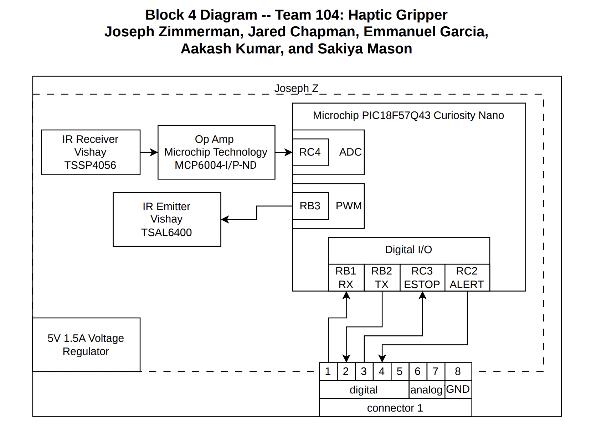

## Overview

This Block Diagram serves as an intial visualization of the final requirements of the circuit. The circuit runs on one main 5V power source, which the major components tie into as needed. The IR Emitter runs off the board's integrated PWM, and the IR Receiver feeds into an Analog to Digital Converter. The board connects to the main control hub through an eight-wire ribbon cable.

## Block Diagram 

