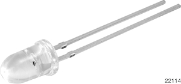
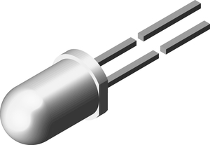
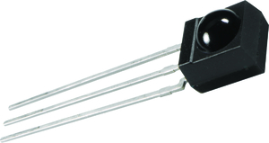
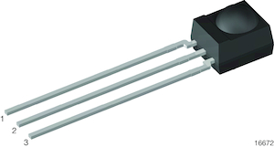

**Infrared (IR) Emitter**

1. VSLY5940 Infrared Emitter

    

    * $1.56/each
    * [link to product](https://www.newark.com/vishay/vsly5940/infrared-emitter-940nm-t-1-3-4/dp/72Y6513)

    | Pros                                      | Cons                                                             |
    | ----------------------------------------- | ---------------------------------------------------------------- |
    | 10ns Rise/Fall Time                       | 3 Degree Angle of Half Intensity                                 |
    | Highest Radiant Intensity                 | Most Expensive                                                   |
    |                                           |                                                                  |

2. TSAL6400 Infrared Emitter

    

    * $0.52/each
    * [Link to product](https://www.newark.com/vishay/tsal6400/ir-emitter-940nm-t-1-3-4-through/dp/95B4859)

    | Pros                                                              | Cons                |
    | ----------------------------------------------------------------- | ------------------- |
    | 25 Degree Angle of Half Intensity                                 | Lowest Radiant Intensity  |
    | Less Expensive                                                    | Lower Max Voltage   |
    |                                                                   |

3. TSAL6100 Infrared Emitter

    

    * $0.52/each
    * [Link to product](https://www.newark.com/vishay/tsal6100/ir-emitter-940nm-10-t-1-3-4-5mm/dp/78Y9604)

    | Pros                                                              | Cons                |
    | ----------------------------------------------------------------- | ------------------- |
    | 10 Degree Angle of Half Intensity                                 | Lower Radiant Intensity |
    | Less Expensive                                                    | Lower Max Voltage    |
    |                                                                   |

**Choice:** Option 2: TSAL6400 Infrared Emitter

**Rationale:** Given the intended short-range application, the greater Angle of Half Intensity provided by this option is more important than the lower radiant intensity. It is also one of the two cheaper options, with only a very small increase in the Rise/Fall times as a result.

**Infrared (IR) Receiver**

1. TSSP4P38 IR Receiver

    

    * $1.99/each
    * [link to product](https://www.newark.com/vishay/tssp4p38/ir-receiver-45m-0-12mw-m2-side/dp/48W3619)

    | Pros                                      | Cons                                                             |
    | ----------------------------------------- | ---------------------------------------------------------------- |
    | Inexpensive                               | Most Expensive                                                   |
    | Compatible with PSoC                      | Needs special PCB layout.                                        |
    | Meets surface mount constraint of project |

2. TSSP4056 Infrared Receiver

    

    * $1.36/each
    * [Link to product](https://www.newark.com/vishay/tssp4056/ir-receiver-25m-0-4mw-m2-side/dp/02AC3955)

    | Pros                                                              | Cons                |
    | ----------------------------------------------------------------- | ------------------- |
    | Outputs a square wave                                             | More expensive      |
    | Stable over operating temperature                                 | Slow shipping speed |
    | Direct interface with PSoC (no external circuitry required) range |

3. TSSP94038 IR Receiver

    

    * $1.08/each
    * [Link to product](https://www.newark.com/vishay/tssp94038/ir-receiver-38khz-12m-side-view/dp/58AJ2797)

    | Pros                                                              | Cons                |
    | ----------------------------------------------------------------- | ------------------- |
    | Least Expensive                                             | More expensive      |
    | Stable over operating temperature                                 | Slow shipping speed |
    | Direct interface with PSoC (no external circuitry required) range |

**Choice:** Option 2: CTX936TR-ND surface mount oscillator

**Rationale:** A clock oscillator is easier to work with because it requires no external circuitry in order to interface with the PSoC. This is particularly important because we are not sure of the electrical characteristics of the PCB, which could affect the oscillation of a crystal. While the shipping speed is slow, according to the website if we order this week it will arrive within 3 weeks.