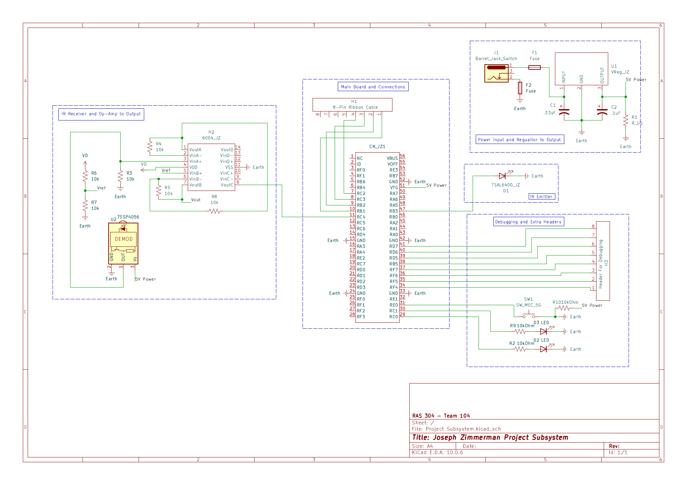

## Overview

This schematic is design to support an Infrared Emitter paired to an IR Receiver, acting as a proximity sensor. The circuit runs on one main 9V power source, fed throgh a voltage regulator to 5 Volts which the major components tie into as needed. The IR Emitter runs off the board's integrated PWM, and the IR Receiver feeds into an Analog to Digital Converter through an Op-AMp that strengthens the analog signal. The board connects to the main control hub through an eight-wire ribbon cable. 
Also included are two LED's and a swtich for debugging, as well as additional pin connections for additonal circuits or testing purposes.

{style width:"350" height:"300;"}
**Figure 1:** The Schematic Itself.

## Resouces

The schematic as a PDF download is available [*here*](Project_Subsystem.pdf), and the Zip folder of the project [*here*](Project_Subsystem.zip).