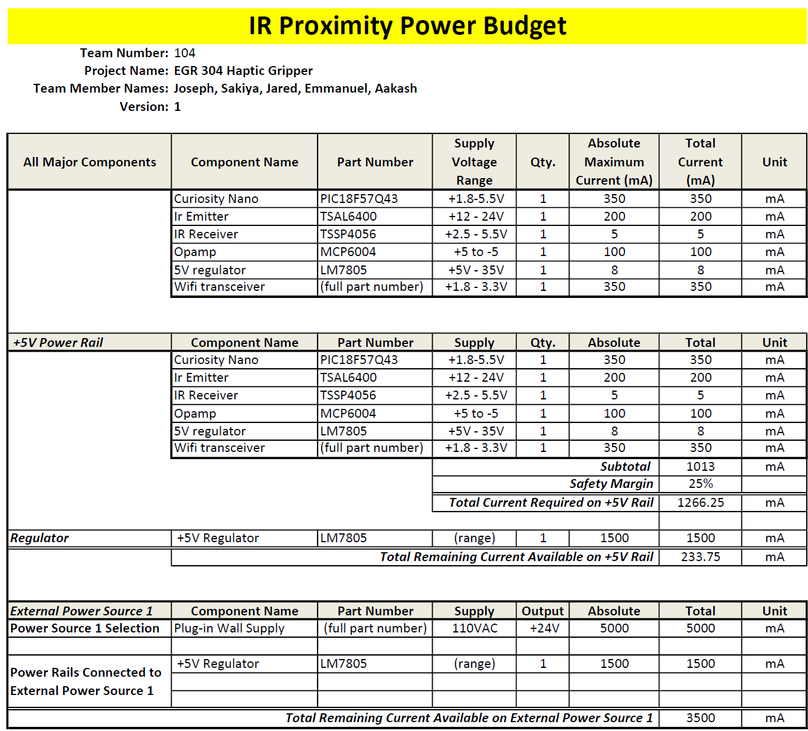

## Overview
This Board needs to power the IR Emitter and Receiver, and while the majority of the components are relatively low in current draw, plotting the actual values ensures that the planned power source is adequate for the intended purpose.

{style width:"350" height:"300;"}

## Conclusions

From the prepared Power Budget, the single 5V voltage regulator fed from external power will be adequate to supply the voltage and current the board.

## Resouces

The power budget as a PDF download is available [*here*](IRPRoximityPowerBudget.pdf), and a Microsoft Excel Sheet [*here*](IRPRoximityPowerBudget.xlsx).
